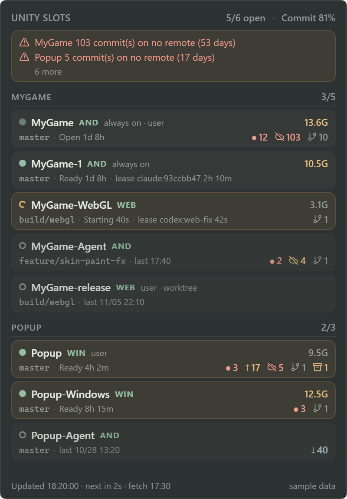
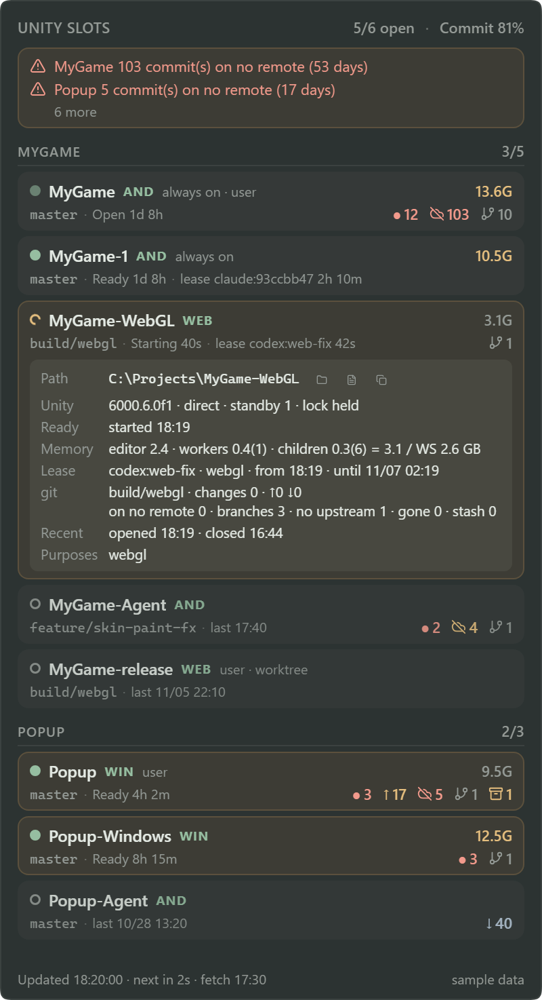
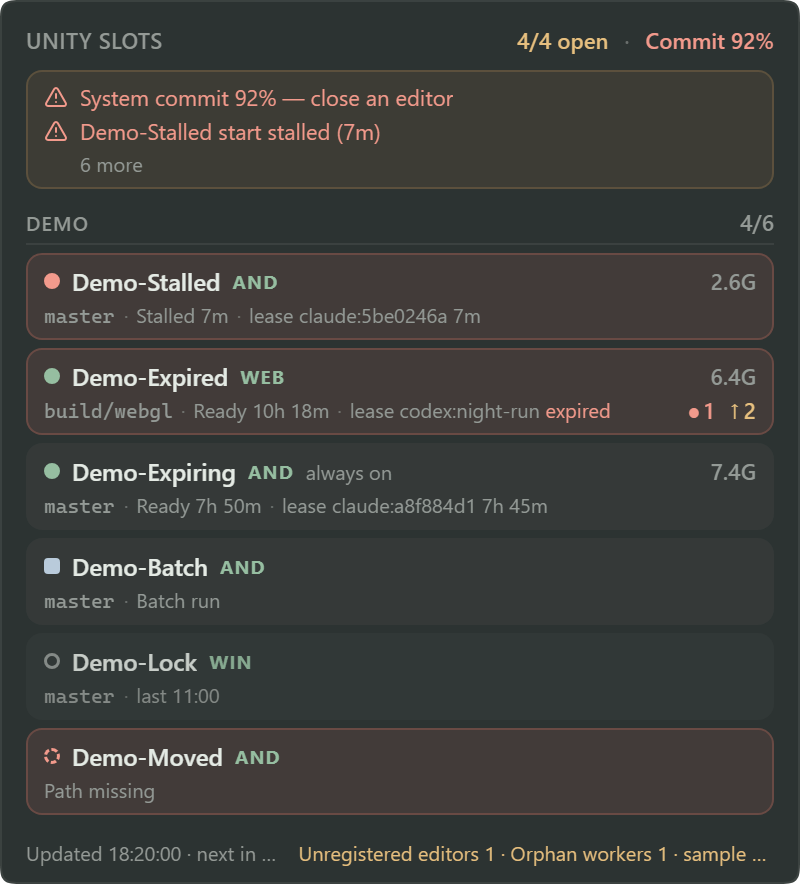
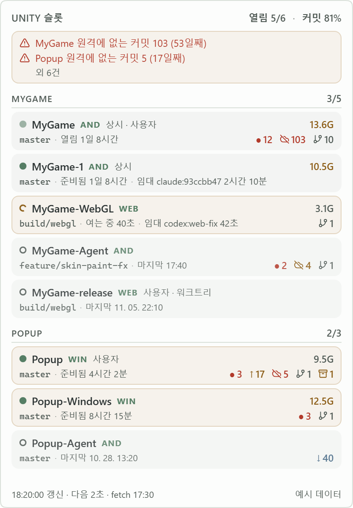
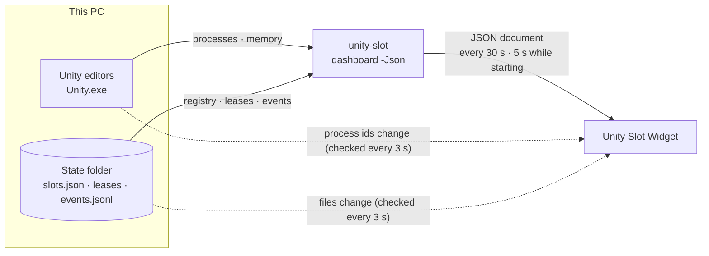
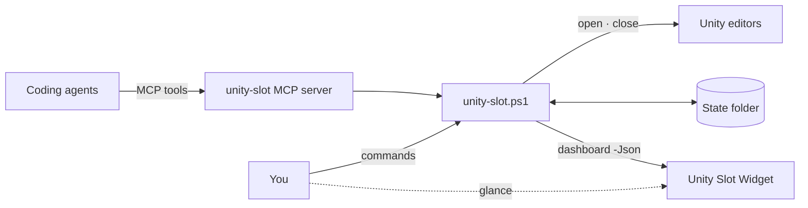

# Unity Slot Widget

[한국어](README.md)


A small desktop widget for [unity-slot](https://github.com/cyKim0115/unity-slot). For each Unity clone (slot) it shows at a glance:

- whether the editor is open, starting or closed
- who holds a lease
- how much memory the editor tree uses
- git work that exists only on this PC

<p align="center">
  
</p>

The widget is **read-only**. It never opens, closes or leases a slot. `unity-slot dashboard -Json` makes every decision and the widget only draws that document. The screenshots use [sample data](samples/).

## What it shows

| Where | What |
|---|---|
| Header | Open editors / maximum (`maxEditors`), system commit % (85% warning, 90% critical) |
| Warning band | An editor open without a lease, an expired lease on an open editor, a stalled start, an unsaved scene, old local-only commits, and more. Click to see them all |
| Slot card | State dot, name, platform, always-on / user / worktree tags, branch, state and time, lease, memory, git marks |
| Footer | Updated time, next check, last fetch, unregistered editors and orphan workers, unity-slot version |

**State dot:** ● ready · ◐ starting · red ● stalled · ○ closed · ■ batch · dim ● open (started by the Hub, readiness unknown) · dashed ○ path missing

**git marks:**

| Mark | Meaning |
|---|---|
| `● 12` | Uncommitted changes |
| `↑ 1` · `↓ 2` | Ahead of / behind upstream (as of the last fetch) |
| crossed cloud `103` | Commits on no remote; amber after 3 days, red after 14 |
| branch `10` | Branches without an upstream |
| broken link `1` | Branches whose upstream is gone |
| box `1` | Stashes |

Click a card to open its details. You get the path (open folder, open log, copy path), the Unity version and how it was started, time to ready, the memory breakdown, the lease period, git details, and the last open and close.

<p align="center">
  
  &nbsp;
  
</p>

The right-click menu has Settings, Refresh, **Copy cleanup request**, Recent events and Quit. Copy cleanup request puts a Markdown checklist of the items that need attention on the clipboard: commits on no remote, branches without an upstream, stashes, editors open without a lease. Paste it into any agent session; the agent asks what to do with each item and does only what you approve.

With a light system theme the widget turns light too. The text comes in Korean and English and follows the system language by default.

<p align="center">
  
</p>

## How it works



- **Full check.** Runs `unity-slot dashboard -Json -Git basic` in a hidden window (20-second limit, one at a time). Detailed git state such as commits on no remote (`-Git full`) comes every 5 minutes and when a card is opened for the first time.
- **Quick check.** Every 3 seconds it looks only at the list of Unity.exe process ids (ToolHelp) and the size and time of the state-folder files. No process is started, so it takes a few ms. When something changes, a full check follows one second later.
- **Hidden means paused.** Hidden to the tray, both stop; when shown again it checks once right away.
- **No fetch.** `↓` is as of the last fetch, whose time is in the footer.

Measured on Windows 10 with 4 editors and 8 slots:

| Item | Value |
|---|---|
| Widget process tree (with WebView2) | 216 MB private |
| Widget CPU | about 1% of one core |
| One full check | basic about 1.7–2 s, full about 2.2–2.5 s |
| Average CPU including checks | about 5% of one core |

## With unity-slot



The widget finds unity-slot in this order and uses the first hit:

1. "unity-slot.ps1 location" in Settings
2. the `UNITY_SLOT_SCRIPT` environment variable
3. `install.json` in the state folder (unity-slot records its location there on every run)
4. `unity-slot.ps1` or `unity-slot.cmd` on `PATH`

The state folder is `UNITY_SLOT_HOME`, or `%USERPROFILE%\.unity-slot`, the same rule unity-slot uses. When the document's schema major differs (`unity-slot.dashboard/2` and later), the widget only says that the versions do not match. This widget reads schema 1.

## Install

### Release

Download `Unity Slot Widget_<version>_x64-setup.exe` from [Releases](https://github.com/cyKim0115/unity-slot-widget/releases) and run it. It installs for the current user only, without admin rights. Check the file against the SHA-256 published with it.

> The installer is not code-signed, so on first run Windows SmartScreen may show "Windows protected your PC". Choose **More info → Run anyway**. If you would rather not, build from source.

### From source

You need Node.js 20 or later, Rust stable, the Visual Studio C++ Build Tools and the WebView2 runtime.

```powershell
git clone https://github.com/cyKim0115/unity-slot-widget
cd unity-slot-widget
npm install
npm run tauri dev          # development run
```

`start.bat` builds a release exe, installs it to `%LOCALAPPDATA%\UnitySlotWidget` and starts it. Later runs rebuild only when the source changed. Run it from Explorer or your own terminal. An agent shell that runs inside an app container may virtualize AppData writes and install it somewhere else.

To see the screens without Tauri, run `npm run dev` and open `http://localhost:1431/?sample=dashboard&lang=en` in a browser. The samples are in `samples/`; there is also `sample=states`.

## Settings

Open them from the tray icon or the widget's right-click menu. They are saved to `<state folder>\widget.json`. That is the unity-slot state folder, not AppData, so people and agents see the same file. Only the window position is stored separately.

| Setting | Default | Meaning |
|---|---|---|
| Language | System language | Korean or English |
| Always on top | On | Above other windows |
| Start with Windows | **Off** | Only in the installed app |
| Background blur | Off | Captures the screen behind the widget and blurs it. While it captures, the widget is left out of screenshots |
| Full check interval / while starting | 30 s / 5 s | |
| Detailed git check interval | 5 min | |
| Quick check interval | 3 s | |
| System commit warning / critical | 85% / 90% | |
| Memory warning for one slot | 10 GB | |
| Commits on no remote warning / critical | 3 / 14 days | |
| unity-slot.ps1 location | empty | Empty means the order above |

## What it does not do

- Open, close or lease slots, end processes, or write to git (including fetch, pull and push)
- Talk to the network or open a local port. The page and Rust talk over Tauri IPC only.
- Show command lines. unity-slot's dashboard output has none (Hub tokens and the like).
- Start automatically by default

## License

[MIT](LICENSE). See [THIRD_PARTY_NOTICES.md](THIRD_PARTY_NOTICES.md) for icons and libraries.
