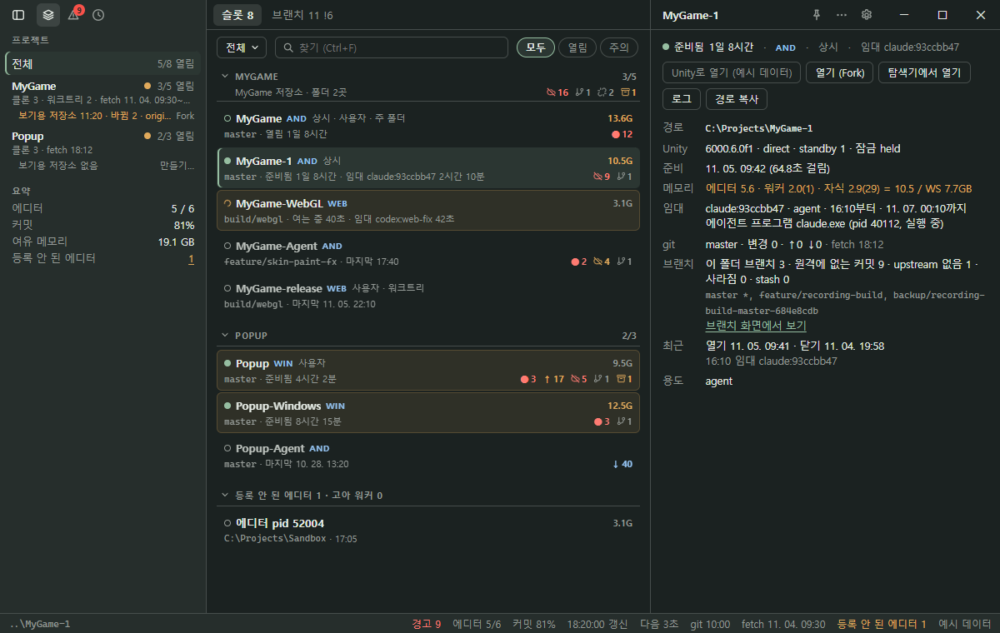
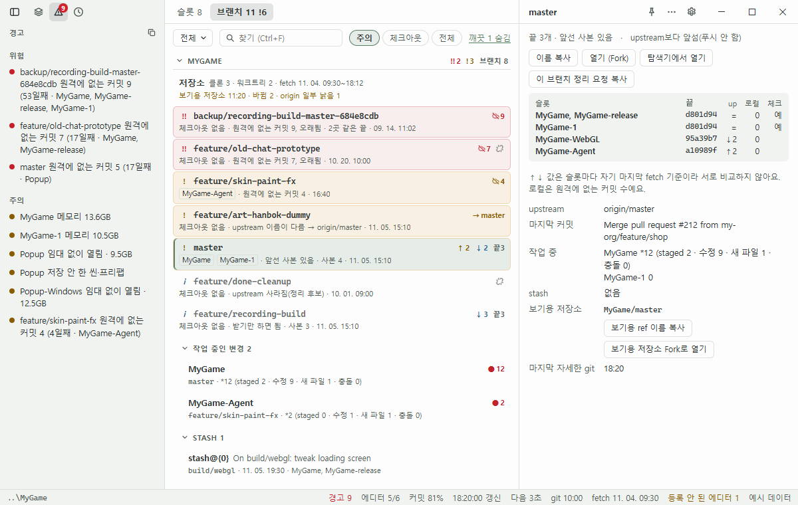
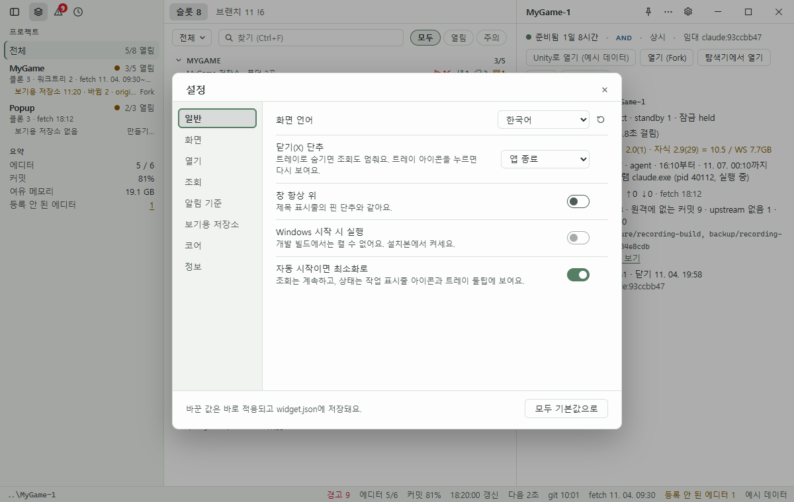
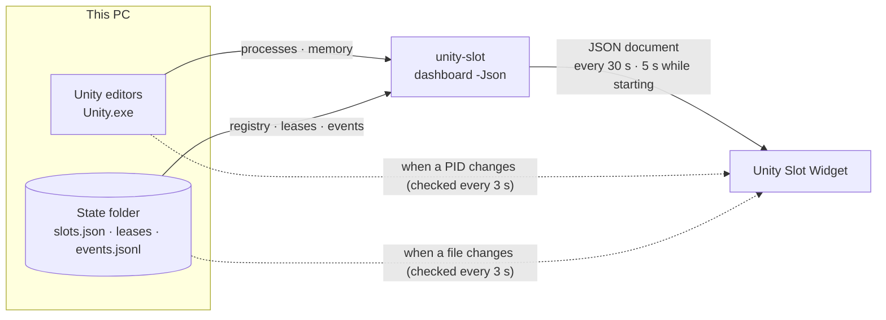
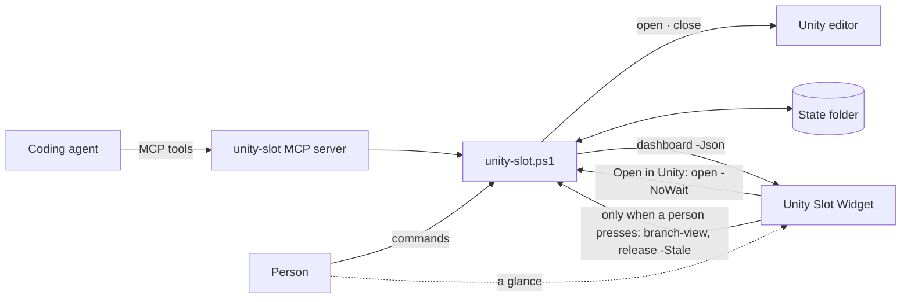

# Unity Slot Widget

[한국어](README.md)


A desktop app for [unity-slot](https://github.com/cyKim0115/unity-slot). For each Unity clone (slot) it shows at a glance:

- whether the editor is open, starting or closed, who holds a lease, and how much memory it uses
- git work that exists only on this PC (commits on no remote, branches without an upstream, stashes, uncommitted changes)
- whether a branch with the same name in several clones is the same, only needs a pull, or has diverged

<p align="center">
  
</p>

The app never closes or leases a slot. The only lease it releases is a stale one (the editor is closed, and the lease ran out or the program that took it has exited), when a person confirms and presses the button; that calls the core's `release <slot> -Stale`. The only thing that starts an editor is **Open in Unity**, and it only calls unity-slot `open -NoWait`, so the core decides the checks before opening and how the editor is started. Every judgment comes from `unity-slot dashboard -Json`; the app draws that document. The screenshots use the [sample data](samples/) (Korean UI).

## Layout

The window has three columns and a status bar. The app draws its own title bar (drag an empty spot to move, double-click to maximize, snap to screen edges).

| Area | Contents |
|---|---|
| Side panel (left) | Three tabs. **Projects**: open count, clone count, fetch range and viewing repository state per project, plus a summary (editors, system commit, free memory, unregistered editors). **Warnings**: critical, attention and info items, and Copy cleanup request. **Log**: recent events (a click selects that slot) |
| List (middle) | Tabs at the top switch between the **Slots** screen and the **Branches** screen. Project picker, search and filter chips |
| Details (right) | Details of the selected item, with a row of action buttons on top. Drag the edge to change its width |
| Banner | Only the one thing a person should handle now (a stalled start, commit charge critical, a core error) |
| Status bar | Selected path, warning count, editors open/max, system commit %, refresh time and next refresh, last detailed git, oldest fetch, unregistered editors, core version. Less important items drop out first when it is narrow |

Below 1000px the side panel opens over the list; below 720px the details open as a sheet below. The minimum size is 400x300.

### Slots screen

Two lines per slot. Line 1: status dot, name, platform, permanent/user/worktree marks, memory. Line 2: branch, state and time, lease, git marks. When slots open or close and the order changes, rows slide to their new place, and a slot glows once when it opens or becomes ready.

**Status dots:** ● ready · ◐ starting · red ● stalled · ○ closed · ■ batch · dim ● open (opened from Hub, readiness unknown) · dashed ○ path missing

**Git marks:**

| Mark | Meaning |
|---|---|
| `● 12` | uncommitted changes |
| `↑ 1` · `↓ 2` | ahead of / behind the upstream (as of the last fetch) |
| struck-through cloud `103` | commits on no remote; amber when old (3 days), red (14 days) |
| branch `10` | branches without an upstream |
| broken link `1` | branches whose upstream is gone |
| box `1` | stashes |

### Branches screen

<p align="center">
  
</p>

Each project shows its repository row, then branches by severity, then uncommitted changes, then stashes. When a branch with the same name is in several clones, the app judges them:

| Verdict | Meaning |
|---|---|
| Same tip | every copy has the same tip |
| Only needs a pull | every copy has an upstream of the same name, and none is ahead or has commits on no remote |
| A copy is ahead | tips differ and a copy is ahead of its upstream |
| Copies diverged | a copy has commits on no remote and the tips differ |
| Cannot compare | a copy has no upstream or an upstream with another name |

Filters: **Attention** (default, hides only the clean ones) · **Checked out** · **All**. `!N` on the tab is critical plus attention. Who has a branch checked out comes from the quick (basic) data; values such as commits on no remote come from the detailed (full) git data. The Branches screen needs core 0.7.0 or later; with an older core it shows only counts per repository.

### Viewing repository

Each clone has its own branches, so one Fork window cannot show them all. The **viewing repository** is a bare repository with one remote per slot, so every slot's branches can be seen in one repository.

- The app never writes to slot repositories. The viewing repository is created and updated by the core's `branch-view` only when a person presses **Create…** or **Update**. The app first shows the plan (expected size and so on) and goes ahead only after you confirm.
- The core only reads the slots. The viewing repository is **not a backup.**
- Its location is a core setting; the app shows it read-only.

### Settings

<p align="center">
  
</p>

Dark theme: [Slots](docs/assets/app-slots-dark.png) · [Branches](docs/assets/app-branches-dark.png) · [Settings](docs/assets/app-settings-dark.png). Light theme slots: [Slots](docs/assets/app-slots-light.png).

## Window behavior

| Item | Behavior |
|---|---|
| First size | 1200x760. Position, size and maximized state are remembered |
| Corners | The window and the small widget have rounded corners and a light shadow (on Windows 10 too). Maximized, the window fills the screen with square corners. Dragging the thin outer margin at the window's edge resizes it |
| Close (X) | Quits the app. Settings can change it to "Hide to tray" or "Small widget" |
| Small widget | With the close button set to "Small widget", a small frameless window stays on top instead of the main window. Under a "Unity Slot" title line it lists only the open editors (starting, ready, stalled, batch), one row each with state, time, lease, branch and memory; rows appear and fold away as editors open and close. With no editor open the widget hides too, and it comes back without taking the focus when one opens. A click brings the main window back with that slot selected; dragging moves it (the position is remembered). It starts in the bottom-right corner of the monitor the window was on; placed in the lower half of a screen it grows and shrinks from its bottom edge. A left click on the tray icon also brings the window back. With this setting the widget window is made ahead, hidden, and draws the last state read first, so it shows right after the close (tens of ms) |
| Tray | Left click shows or hides. Menu: show window, settings, quit. The tooltip shows the worst state (for example "editors 5/6 · stalled 1 · warnings 5") |
| Minimized | Refreshing goes on while minimized. The taskbar icon carries a critical/attention overlay, and the taskbar flashes when a new critical state appears (stalled start, commit charge critical). Refreshing stops only when hidden to the tray |
| Start with Windows | Off by default; only an installed copy can turn it on. Started by Windows, it starts minimized (a setting) |
| Single instance | Running the installed app again brings the existing window to the front (not in development builds) |
| Always on top | Off by default. The pin button in the title bar = the "Window always on top" setting |

The theme follows the system; `Ctrl+Shift+D` or the settings fix light or dark. The UI text comes in Korean and English and follows the system language by default.

**Animation:** theme changes, screen changes, list reordering and the details and banner appearing move once, briefly. Nothing repeats. With Windows "Animation effects" off (reduced motion), everything changes at once.

## Shortcuts

| Keys | Action |
|---|---|
| `Ctrl+1` / `Ctrl+2`, `Ctrl+Tab` | Slots / Branches screen, next screen |
| `Ctrl+Shift+E` / `Ctrl+\` | Toggle the side panel / the details column |
| `Ctrl+F`, `Esc` | Search the list; close search, menus and popups |
| `↑ ↓ Home End`, `← →`, `Enter` | Move in the list, collapse or expand a group |
| `Shift+F10` / Menu key | Context menu of the selected row |
| `Ctrl+C` / `Ctrl+O` | Copy the path or branch name / open with the open program |
| `Ctrl+Shift+C` | Copy cleanup request (the selected project) |
| `F2` | Rename the selected project (a row pressed in the Projects panel comes first) |
| `F5` / `Shift+F5` | Refresh / refresh detailed git |
| `Ctrl+,` / `Ctrl+Shift+D` | Settings / light or dark |

Open in Unity has no shortcut: an editor started by mistake uses a lot of memory.

## Context menus

- Slot: **Open in Unity**, open with the open program (Fork by default), Explorer, copy path. Open in Unity calls `unity-slot open <slot> -NoWait`, so the core's checks apply as they are: already open, a batch run, a locked `Temp\UnityLockfile`, a Unity version that is not installed, and capacity warnings. The platform (`-BuildTarget`) is not passed. On an open slot it becomes **Show Unity window**. It is disabled for a closed slot leased by someone else, a slot whose folder is missing, and a slot in a batch run. It does not take a lease.
- Slot: **Release stale lease** shows only on a slot the core's dashboard marks `lease.stale` (no editor or batch run, and the lease ran out or the agent program that took it has exited). The confirmation shows the command it runs (`unity-slot release <slot> -Stale`); the core checks the state again and removes only the lease file. If an editor opened or the lease was renewed meanwhile, the core refuses and changes nothing. It never touches an editor and never releases a lease in use (for that, the CLI `release <slot> -AnyOwner`).
- Project: collapse the group, show only this project, **Rename**, copy a cleanup request for this project. The Branches screen's project and repository rows have it too.
- **Rename** (`F2`, or the button in the project's details) gives a project a nickname that only this widget's screens use, for example a short name in your own language for a long English repository name. Group heads, the Projects tab, titles and menus show the nickname; hovering shows the original name. Search finds a project by either name. Save it empty to show the original name again. Nicknames are stored in `projectAliases` (original name → nickname) of `<state folder>\widget.json`, up to 40 characters. The core's registry, the repositories and cleanup requests keep the original name.
- Branch: copy name, open a slot that has it checked out with the open program, Explorer, copy a cleanup request for this branch, copy the viewing ref name.
- **Copy cleanup request** puts the items to look at (commits on no remote, branches without an upstream, stashes, editors open without a lease and so on) on the clipboard as a Markdown checklist. Paste it into an agent session; the agent asks what to do with each item and handles only what you approve.

## How it works



- **Full refresh:** runs `unity-slot dashboard -Json -Git basic` in a hidden window (one at a time). Detailed git (`-Git full`), such as commits on no remote, comes every 5 minutes, and when you enter the Branches screen and the last one is older than 60 seconds.
- **Quick check:** every 3 seconds it looks only at the list of Unity.exe process IDs and the size and time of the files in the state folder. No process is started. On a change, a full refresh follows soon.
- **No fetch.** `↓` is as of the last fetch, whose time is in the status bar.

## With unity-slot

**Core needed: unity-slot 0.7.0 or later** (Branches screen and viewing repository). With 0.6.x the Slots screen still works.



The app finds unity-slot in this order and uses the first it finds:

1. "unity-slot.ps1 location" in the settings
2. the environment variable `UNITY_SLOT_SCRIPT`
3. `install.json` in the state folder, which unity-slot writes each time it runs
4. `unity-slot.ps1` or `unity-slot.cmd` on `PATH`

The state folder is `UNITY_SLOT_HOME`, or `%USERPROFILE%\.unity-slot`. If the document's schema major number differs (`unity-slot.dashboard/2` and so on), the app only says the versions do not match. This app reads schema 1.

## Install

### Release

Download `Unity-Slot-Widget_<version>_x64-setup.exe` from [Releases](https://github.com/cyKim0115/unity-slot-widget/releases) and run it. It installs for the current user only and needs no administrator rights. Check the file with the SHA-256 published next to it.

> The installer is not code-signed, so on first run Windows SmartScreen may show "Windows protected your PC". Choose **More info → Run anyway**. If you would rather not, build from source as below.

### From source

You need Node.js 20 or later, Rust stable, Visual Studio C++ Build Tools and the WebView2 runtime.

```powershell
git clone https://github.com/cyKim0115/unity-slot-widget
cd unity-slot-widget
npm install
npm run tauri dev          # development run
npm test                   # unit tests (vitest)
```

`start.bat` (or `시작.bat`) builds the release exe, installs it to `%LOCALAPPDATA%\UnitySlotWidget` and runs it. Run again, it rebuilds only when the source changed. Run it from Explorer or a terminal you opened yourself: from an agent shell inside an app container, AppData writes are virtualized and it may install somewhere else.

`scripts\build-release.ps1` makes the installer. It strips user folders from the source paths Rust puts in the executable and stops if any remain. At the end it writes `SHA256SUMS.txt`.

To see the screens without Tauri, run `npm run dev` and open `http://localhost:1431/?sample=dashboard&lang=en` in a browser. Samples are in `samples/` (`sample=states`, `sample=old-core`); it also takes `theme=light|dark`, `view=slots|branches`, `nav=projects|warnings|log` and `frame=1200x760`.

## Settings items

The gear in the title bar, the tray menu or `Ctrl+,`. A change applies at once and is saved to `<state folder>\widget.json`. People and agents share that file, so only the changed keys are merged in. Each item has a reset button, and there is "Reset all". Screen state (side panel tab, column widths, screen tab, filters, selection) is kept by the app separately.

| Category | Item | Default |
|---|---|---|
| General | Display language | system language |
| | Close (X) button | quit the app (or hide to tray, or small widget) |
| | Window always on top | off |
| | Start with Windows | off (installed copy only) |
| | Start minimized when started with Windows | on |
| Display | Theme | system (light, dark) |
| | Theme transition | 250 ms (0 to 1000) |
| Open | Open program | **Fork** (Command Prompt, Git Bash, Cursor, VS Code, Explorer) |
| Refresh | Normal / while starting | 30 s / 5 s |
| | Detailed git | 5 min |
| | Quick change check | 3 s |
| Alerts | System commit attention / critical | 85% / 90% |
| | Memory per slot attention | 10 GB |
| | Commits on no remote attention / critical | 3 days / 14 days |
| | Flash the taskbar on a new critical state | on |
| Viewing repository | Open in Fork after an update | on |
| Core | unity-slot.ps1 location | empty (found in the order above) |
| | Sample data file | empty (development) |
| About | App and core versions, settings file location, license | |

There are no background blur or translucent background settings (removed in 0.2.0). Only the area outside the rounded corners is transparent; the content is opaque. `glass`, `glassBlur` and `alwaysOnTop` in an old `widget.json` are not read, and saving does not remove them either.

## What it does not do

- It never writes to slot repositories (no fetch, pull, push or checkout). The viewing repository is created and updated by the core's `branch-view` only when a person presses the button. The viewing repository is not a backup.
- Close or lease slots, release a lease in use, or end processes. It never starts Unity.exe itself; Open in Unity is done by unity-slot `open`.
- Network traffic or a local port. The UI and Rust talk only over Tauri IPC.
- Show command lines. unity-slot's dashboard output has none (Hub tokens and so on).
- Start with Windows by default.

## Sources and license

[MIT](LICENSE). The window frame (title bar, side panel, column resizing, menus, dialogs, banner, status bar, themes, settings popup, shortcuts) was taken from [Frond](https://github.com/cyKim0115/Frond/) (commit `99d89bc`), an MIT app by the same author, and changed. Per-file sources are in [src/shell/SOURCES.md](src/shell/SOURCES.md). For icons and libraries see [THIRD_PARTY_NOTICES.md](THIRD_PARTY_NOTICES.md).
