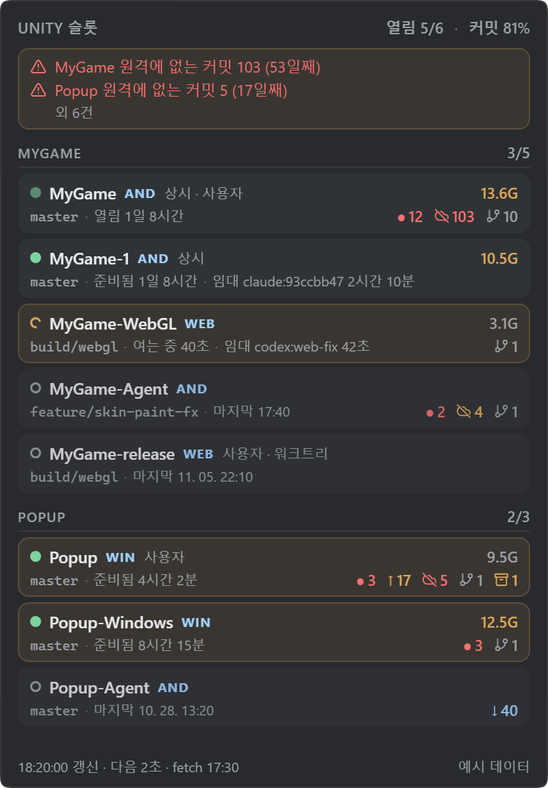
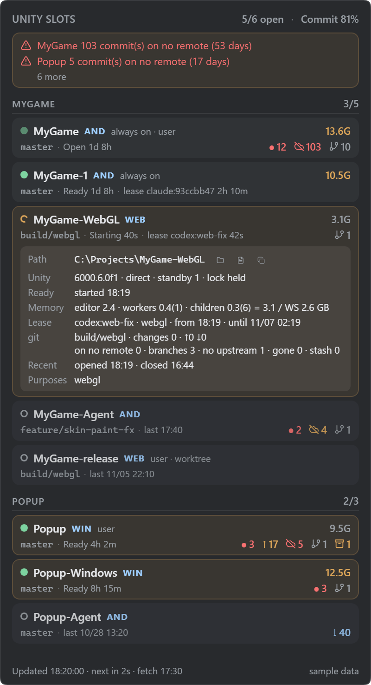
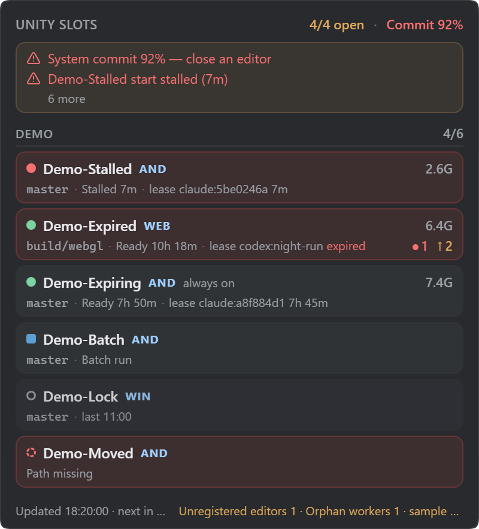
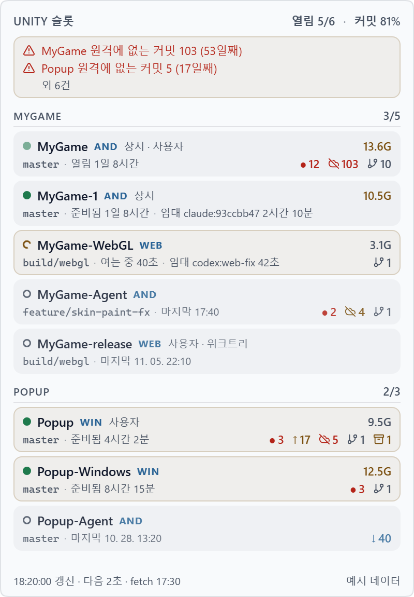
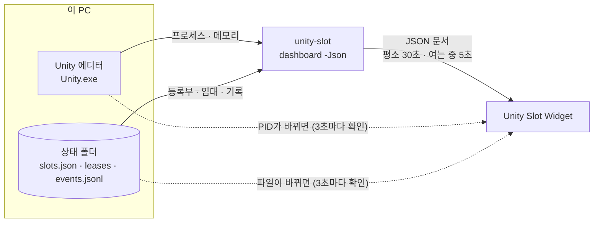
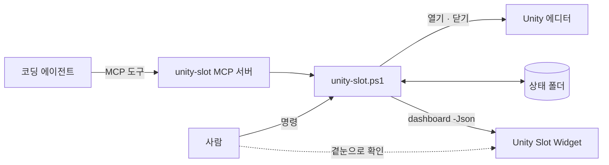

# Unity Slot Widget

[English](README.en.md)


[unity-slot](https://github.com/cyKim0115/unity-slot)과 함께 쓰는 작은 데스크톱 위젯입니다. Unity 클론(슬롯)마다 다음을 한눈에 보여 줍니다.

- 에디터가 열렸는지·여는 중인지·닫혔는지
- 누가 임대했는지
- 에디터 트리가 메모리를 얼마나 쓰는지
- 이 PC에만 있는 git 작업이 무엇인지

<p align="center">
  
</p>

위젯은 **읽기 전용**입니다. 슬롯을 열거나 닫거나 임대하지 않습니다. 판단은 모두 `unity-slot dashboard -Json`이 하고, 위젯은 그 문서를 그리기만 합니다. 스크린샷은 [예시 데이터](samples/)로 찍었습니다.

## 보여 주는 것

| 자리 | 내용 |
|---|---|
| 머리 띠 | 열린 에디터 수 / 최대(`maxEditors`), 시스템 커밋 % (85% 주의, 90% 위험) |
| 경고 띠 | 임대 없이 열린 에디터, 만료된 임대인데 열린 에디터, 시작 멈춤, 저장 안 한 씬, 오래된 로컬 커밋 같은 것. 누르면 모두 펼칩니다 |
| 슬롯 카드 | 상태 점, 이름, 플랫폼, 상시·사용자·워크트리 표시, 브랜치, 상태와 시간, 임대, 메모리, git 표시 |
| 바닥 줄 | 갱신 시각, 다음 조회까지, 마지막 fetch, 등록 안 된 에디터·고아 워커, unity-slot 버전 |

**상태 점:** ● 준비됨 · ◐ 여는 중 · ● 빨강 멈춤 · ○ 닫힘 · ■ batch · 흐린 ● 열림(Hub로 열어 준비 여부를 모름) · 점선 ○ 경로 없음

**git 표시:**

| 표시 | 뜻 |
|---|---|
| `● 12` | 커밋 안 한 변경 |
| `↑ 1` · `↓ 2` | upstream보다 앞섬·뒤짐(마지막 fetch 기준) |
| 구름에 빗금 `103` | 어느 원격에도 없는 커밋. 오래되면 노랑(3일)·빨강(14일) |
| 브랜치 `10` | upstream이 없는 브랜치 |
| 끊긴 고리 `1` | upstream이 사라진 브랜치 |
| 상자 `1` | stash |

카드를 누르면 자세한 내용이 펼쳐집니다. 경로(폴더 열기·로그 열기·경로 복사), Unity 버전과 실행 방식, 준비까지 걸린 시간, 메모리 내역, 임대 기간, git 자세히, 최근 열기·닫기예요.

<p align="center">
  
  &nbsp;
  
</p>

우클릭 메뉴에는 설정, 새로고침, **정리 요청 복사**, 최근 이벤트, 종료가 있습니다. 정리 요청 복사는 주의할 항목을 마크다운 체크리스트로 클립보드에 넣습니다. 원격에 없는 커밋, upstream 없는 브랜치, stash, 임대 없이 열린 에디터 같은 것이에요. 아무 에이전트 세션에 붙여 넣으면, 에이전트가 항목마다 무엇을 할지 묻고 승인한 것만 처리합니다.

시스템이 라이트 테마면 위젯도 라이트로 바뀝니다. 화면 글자는 한국어·영어 두 벌이고, 기본은 시스템 언어를 따릅니다.

<p align="center">
  
</p>

## 어떻게 동작하나



- **전체 조회:** `unity-slot dashboard -Json -Git basic`을 숨은 창으로 실행합니다(20초 제한, 한 번에 하나). 원격에 없는 커밋 같은 자세한 git 상태(`-Git full`)는 5분마다, 그리고 카드를 처음 펼칠 때 받습니다.
- **빠른 확인:** 3초마다 Unity.exe 프로세스 ID 목록(ToolHelp)과 상태 폴더 파일의 크기·수정 시각만 봅니다. 프로세스를 띄우지 않아 몇 ms면 끝납니다. 바뀌면 1초 뒤 전체 조회를 합니다.
- **숨기면 멈춤:** 트레이로 숨기면 둘 다 멈추고, 다시 보이면 바로 한 번 조회합니다.
- **fetch는 하지 않습니다.** `↓`는 마지막 fetch 기준이고, 그 시각이 바닥 줄에 나옵니다.

실측(Windows 10, 에디터 4개, 슬롯 8개)

| 항목 | 값 |
|---|---|
| 위젯 프로세스 트리(WebView2 포함) | Private 216MB |
| 위젯 자체 CPU | 코어 하나의 약 1% |
| 전체 조회 1회 | basic 약 1.7~2초, full 약 2.2~2.5초 |
| 평균 CPU(조회 포함) | 코어 하나의 약 5% |

## unity-slot과 함께



위젯은 unity-slot을 이렇게 찾습니다. 앞에서부터 처음 찾은 것을 씁니다.

1. 설정 창의 「unity-slot.ps1 위치」
2. 환경변수 `UNITY_SLOT_SCRIPT`
3. 상태 폴더의 `install.json`. unity-slot이 실행될 때마다 자기 위치를 남깁니다.
4. `PATH`에 있는 `unity-slot.ps1` 또는 `unity-slot.cmd`

상태 폴더는 `UNITY_SLOT_HOME`, 없으면 `%USERPROFILE%\.unity-slot`입니다. unity-slot이 쓰는 규칙과 같습니다. 문서의 스키마 주 번호가 다르면(`unity-slot.dashboard/2` 등) 위젯은 버전이 맞지 않는다는 안내만 보여 줍니다. 이 위젯은 스키마 1을 읽습니다.

## 설치

### 릴리스

[Releases](https://github.com/cyKim0115/unity-slot-widget/releases)에서 `Unity-Slot-Widget_<버전>_x64-setup.exe`를 받아 실행합니다. 현재 사용자에게만 설치되고 관리자 권한이 필요 없습니다. 함께 올린 SHA-256으로 파일을 확인할 수 있습니다.

> 설치 파일에 코드 서명이 없어서, 처음 실행할 때 Windows SmartScreen이 「Windows의 PC 보호」를 띄울 수 있습니다. **추가 정보 → 실행**을 누르면 됩니다. 꺼림칙하면 아래처럼 소스에서 빌드하세요.

### 소스에서

필요한 것은 Node.js 20 이상, Rust stable, Visual Studio C++ Build Tools, WebView2 런타임입니다.

```powershell
git clone https://github.com/cyKim0115/unity-slot-widget
cd unity-slot-widget
npm install
npm run tauri dev          # 개발 실행
```

`start.bat`(또는 `시작.bat`)은 릴리스 exe를 빌드하고 `%LOCALAPPDATA%\UnitySlotWidget`에 설치한 뒤 실행합니다. 다시 실행하면 소스가 바뀌었을 때만 다시 빌드합니다. 탐색기나 직접 연 터미널에서 실행하세요. 앱 컨테이너 안에서 도는 에이전트 셸에서 실행하면 AppData 쓰기가 가상화돼 다른 곳에 설치될 수 있습니다.

설치 파일은 `scripts\build-release.ps1`로 만듭니다. Rust가 실행 파일에 넣는 소스 경로에서 사용자 폴더를 지우고, 그래도 남아 있으면 멈춥니다. 끝나면 `SHA256SUMS.txt`를 남깁니다.

Tauri 없이 화면만 보려면 `npm run dev`를 실행한 뒤 브라우저에서 `http://localhost:1431/?sample=dashboard&lang=ko`를 엽니다. 예시는 `samples/`에 있고 `sample=states`도 있습니다.

## 설정

트레이 아이콘이나 위젯 우클릭 → 설정. 값은 `<상태 폴더>\widget.json`에 저장됩니다. AppData가 아니라 unity-slot 상태 폴더라서 사람과 에이전트가 같은 파일을 봅니다. 창 위치만 따로 기억합니다.

| 항목 | 기본값 | 뜻 |
|---|---|---|
| 화면 언어 | 시스템 언어 | 한국어·영어 |
| 항상 위 | 켬 | 다른 창 위에 표시 |
| Windows 시작 시 실행 | **끔** | 설치본에서만 켤 수 있습니다 |
| 배경 흐림 | 끔 | 위젯 뒤 화면을 캡처해 흐립니다. 캡처하는 순간 위젯은 스크린샷에서 빠집니다 |
| 평소 / 여는 중 조회 간격 | 30초 / 5초 | |
| 자세한 git 조회 간격 | 5분 | |
| 빠른 확인 간격 | 3초 | |
| 시스템 커밋 주의 / 위험 | 85% / 90% | |
| 슬롯 하나 메모리 주의 | 10GB | |
| 원격에 없는 커밋 주의 / 위험 | 3일 / 14일 | |
| unity-slot.ps1 위치 | 비움 | 비우면 위의 순서로 찾습니다 |

## 하지 않는 것

- 슬롯 열기·닫기·임대, 프로세스 종료, git 쓰기(fetch·pull·push 포함)
- 네트워크 통신, 로컬 포트 열기. 화면과 Rust 사이는 Tauri IPC만 씁니다.
- 명령줄 표시. unity-slot의 dashboard 출력에는 명령줄이 없습니다(Hub 토큰 등).
- 기본으로 자동 시작하기

## 라이선스

[MIT](LICENSE). 아이콘·라이브러리는 [THIRD_PARTY_NOTICES.md](THIRD_PARTY_NOTICES.md)를 보세요.
