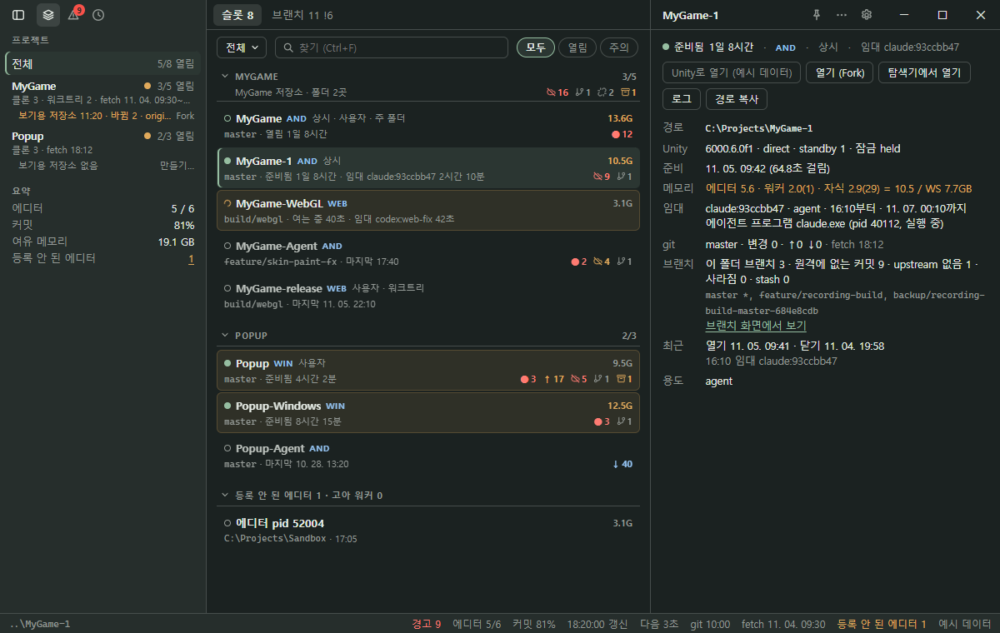
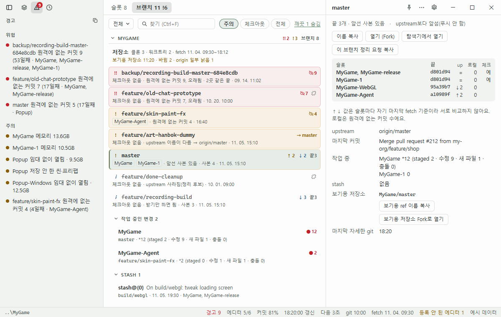
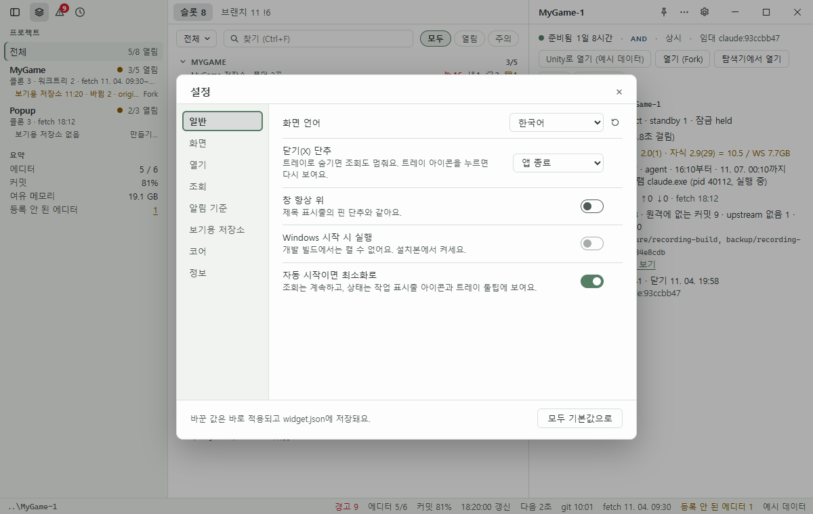
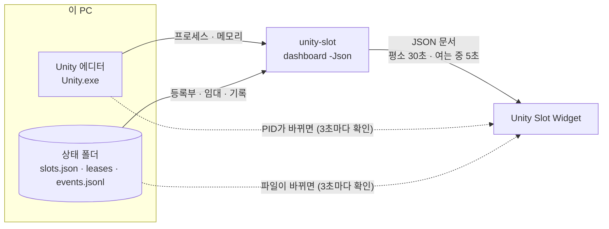
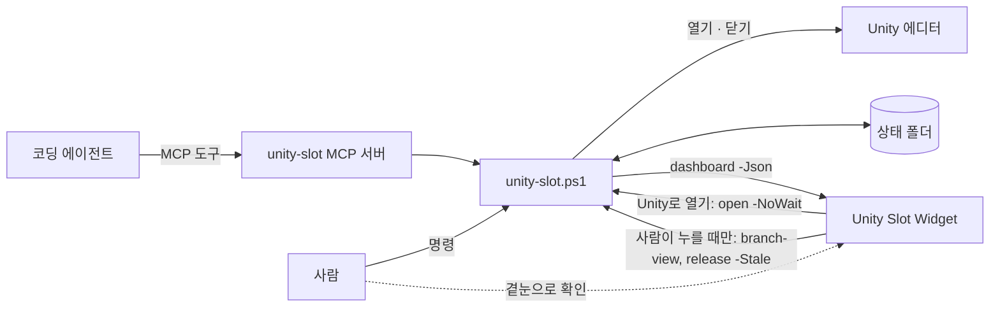

# Unity Slot Widget

[English](README.en.md)


[unity-slot](https://github.com/cyKim0115/unity-slot)과 함께 쓰는 데스크톱 앱입니다. Unity 클론(슬롯)마다 다음을 한눈에 보여 줍니다.

- 에디터가 열렸는지·여는 중인지·닫혔는지, 누가 임대했는지, 메모리를 얼마나 쓰는지
- 이 PC에만 있는 git 작업(원격에 없는 커밋, upstream 없는 브랜치, stash, 작업 중 변경)
- 여러 클론에 흩어진 같은 이름 브랜치가 같은지, 받기만 하면 되는지, 갈라졌는지

<p align="center">
  
</p>

앱은 슬롯을 닫거나 임대하지 않습니다. 임대를 푸는 것은 낡은 임대(에디터는 닫혔고 기한이 지났거나 잡은 프로그램이 끝난 것)를 사람이 확인하고 누를 때 코어 `release <슬롯> -Stale`을 부르는 것뿐입니다. 에디터를 띄우는 것은 **Unity로 열기** 하나뿐이고, 그것도 unity-slot의 `open -NoWait`를 부를 뿐이라 열기 전 검사와 띄우는 방식은 코어가 정합니다. 판단은 모두 `unity-slot dashboard -Json`이 하고, 앱은 그 문서를 그립니다. 스크린샷은 [예시 데이터](samples/)로 찍었습니다.

## 화면 구성

창은 세 열과 상태바입니다. 제목 표시줄은 앱이 직접 그립니다(빈 곳을 끌어 이동, 두 번 눌러 최대화, 화면 끝 붙이기).

| 자리 | 내용 |
|---|---|
| 탐색 영역(왼쪽) | 탭 셋. **프로젝트**: 프로젝트별 열림 수·클론 수·fetch 범위·보기용 저장소 상태와 요약(에디터 수, 시스템 커밋, 여유 메모리, 등록 안 된 에디터). **경고**: 위험·주의·정보 목록과 정리 요청 복사. **기록**: 최근 이벤트(누르면 그 슬롯을 고름) |
| 목록(가운데) | 위쪽 탭으로 **슬롯** 화면과 **브랜치** 화면을 바꿉니다. 프로젝트 고르기, 찾기, 필터 칩이 있습니다 |
| 본문(오른쪽) | 고른 항목의 자세히. 맨 위에 동작 단추 줄. 경계를 끌어 폭을 바꿉니다 |
| 배너 | 사람이 지금 손대야 하는 것 하나만(시작 멈춤, 커밋 위험, 코어 오류) |
| 상태바 | 고른 항목 경로, 경고 수, 에디터 a/최대, 시스템 커밋 %, 갱신 시각·다음 조회, 마지막 자세한 git, 가장 오래된 fetch, 등록 안 된 에디터, 코어 버전. 좁으면 덜 중요한 것부터 뺍니다 |

창 폭이 1000px보다 좁으면 탐색 영역이 목록 위에 겹쳐 열리고, 720px보다 좁으면 본문이 아래 시트로 열립니다. 최소 크기는 400x300입니다.

### 슬롯 화면

슬롯마다 두 줄입니다. 1행은 상태 점, 이름, 플랫폼, 상시·사용자·워크트리 표시, 메모리. 2행은 브랜치, 상태와 시간, 임대, git 표시입니다. 슬롯이 열리거나 닫혀 순서가 바뀌면 항목이 새 자리로 미끄러지고, 열림·준비 완료 때 한 번 빛납니다.

**상태 점:** ● 준비됨 · ◐ 여는 중 · ● 빨강 멈춤 · ○ 닫힘 · ■ batch · 흐린 ● 열림(Hub로 열어 준비 여부를 모름) · 점선 ○ 경로 없음

**git 표시:**

| 표시 | 뜻 |
|---|---|
| `● 12` | 커밋 안 한 변경 |
| `↑ 1` · `↓ 2` | upstream보다 앞섬·뒤짐(마지막 fetch 기준) |
| 구름에 빗금 `103` | 어느 원격에도 없는 커밋. 오래되면 노랑(3일)·빨강(14일) |
| 브랜치 `10` | upstream이 없는 브랜치 |
| 끊긴 고리 `1` | upstream이 사라진 브랜치 |
| 상자 `1` | stash |

### 브랜치 화면

<p align="center">
  
</p>

프로젝트마다 저장소 줄 → 브랜치(심각도 순) → 작업 중인 변경 → stash 순서로 보입니다. 같은 이름 브랜치가 여러 클론에 있으면 앱이 판정합니다.

| 판정 | 뜻 |
|---|---|
| 같은 끝 | 모든 사본의 끝이 같음 |
| 받기만 하면 됨 | 모든 사본이 같은 이름 upstream을 갖고, 앞선 커밋·원격에 없는 커밋이 없음 |
| 앞선 사본 있음 | 끝이 다르고 어느 사본이 upstream보다 앞섬 |
| 사본 끝이 갈라짐 | 원격에 없는 커밋이 있는 사본이 있고 끝이 다름 |
| 비교 불가 | upstream이 없거나 이름이 다른 사본이 섞임 |

필터는 **주의**(기본, 깨끗한 것만 숨김) · **체크아웃** · **전체**입니다. 탭의 `!N`은 위험+주의 수입니다. 누가 체크아웃 중인지는 빠른 조회(basic) 값으로 그리고, 원격에 없는 커밋 같은 값은 자세한 git(full) 값입니다. 브랜치 화면은 코어 0.7.0 이상이 필요하고, 그보다 옛 코어면 저장소마다 개수만 보입니다.

### 보기용 저장소

클론마다 브랜치가 따로라 한곳에서 Fork로 보기 어렵습니다. **보기용 저장소**는 슬롯마다 원격 하나를 둔 bare 저장소로, 모든 슬롯의 브랜치를 한 저장소에서 보게 해 줍니다.

- 앱은 슬롯 저장소에 쓰지 않습니다. 보기용 저장소는 사람이 **만들기…**·**갱신**을 누를 때만 코어 `branch-view`가 만들고 갱신합니다. 누르면 먼저 계획(예상 크기 등)을 보이고, 확인해야 진행합니다.
- 코어는 슬롯을 읽기만 합니다. 보기용 저장소는 **백업이 아닙니다.**
- 위치는 코어 설정값이고, 앱에서는 읽기 전용으로 보입니다.

### 설정

<p align="center">
  
</p>

다크 테마 그림: [슬롯](docs/assets/app-slots-dark.png) · [브랜치](docs/assets/app-branches-dark.png) · [설정](docs/assets/app-settings-dark.png). 라이트 테마 슬롯 화면: [슬롯](docs/assets/app-slots-light.png).

## 창 동작

| 항목 | 동작 |
|---|---|
| 처음 크기 | 1200x760. 위치·크기·최대화는 기억합니다 |
| 닫기(X) | 앱 종료. 설정에서 「트레이로 숨기기」로 바꿀 수 있습니다 |
| 트레이 | 왼클릭으로 보이기·숨기기. 메뉴는 창 보이기·설정·종료. 툴팁에 가장 나쁜 상태(예: 「에디터 5/6 · 멈춤 1 · 경고 5」) |
| 최소화 | 최소화해도 조회는 계속합니다. 작업 표시줄 아이콘에 위험·주의 표시가 겹쳐 보이고, 새 위험(시작 멈춤, 커밋 위험)이 생기면 작업 표시줄이 깜빡입니다. 트레이로 숨겼을 때만 조회를 멈춥니다 |
| 자동 시작 | 기본은 끔이고 설치본에서만 켤 수 있습니다. Windows가 띄우면 최소화로 시작합니다(설정으로 끔) |
| 단일 인스턴스 | 설치본을 두 번 실행하면 이미 있는 창을 앞으로 가져옵니다(개발 빌드는 해당 없음) |
| 항상 위 | 기본 끔. 제목 표시줄의 핀 단추 = 설정 「창 항상 위」 |

테마는 시스템을 따르고, `Ctrl+Shift+D`나 설정으로 라이트·다크를 고정합니다. 화면 글자는 한국어·영어 두 벌이고 기본은 시스템 언어를 따릅니다.

**애니메이션:** 테마 전환, 화면 전환, 목록 순서 바뀜, 본문·배너 등장이 짧게 한 번 움직입니다. 반복하는 애니메이션은 없습니다. Windows의 「애니메이션 효과」를 끄면(동작 줄이기) 모두 바로 바뀝니다.

## 단축키

| 키 | 동작 |
|---|---|
| `Ctrl+1` / `Ctrl+2`, `Ctrl+Tab` | 슬롯 / 브랜치 화면, 다음 화면 |
| `Ctrl+Shift+E` / `Ctrl+\` | 탐색 영역 / 본문 열 접기·펴기 |
| `Ctrl+F`, `Esc` | 목록 찾기, 찾기·메뉴·대화상자 닫기 |
| `↑ ↓ Home End`, `← →`, `Enter` | 목록에서 고르기, 그룹 접기·펴기 |
| `Shift+F10` / 메뉴 키 | 고른 줄의 우클릭 메뉴 |
| `Ctrl+C` / `Ctrl+O` | 경로·브랜치 이름 복사 / 열 프로그램으로 열기 |
| `Ctrl+Shift+C` | 정리 요청 복사(고른 프로젝트 범위) |
| `F2` | 고른 프로젝트 이름 바꾸기 |
| `F5` / `Shift+F5` | 새로고침 / 자세한 git 새로고침 |
| `Ctrl+,` / `Ctrl+Shift+D` | 설정 / 라이트·다크 |

Unity로 열기에는 단축키가 없습니다. 실수로 에디터를 띄우면 메모리를 많이 쓰기 때문입니다.

## 우클릭 메뉴

- 슬롯: **Unity로 열기**, 열 프로그램으로 열기(기본 Fork), 탐색기, 경로 복사. Unity로 열기는 `unity-slot open <슬롯> -NoWait`를 부르므로 이미 열렸는지, batch 실행·잠긴 `Temp\UnityLockfile`·설치 안 된 Unity 버전 검사와 수용량 경고가 코어 그대로 적용됩니다. 플랫폼(`-BuildTarget`)은 넘기지 않습니다. 이미 열린 슬롯에서는 **Unity 창 보기**로 바뀝니다. 남이 임대한 닫힌 슬롯, 폴더가 없는 슬롯, batch 실행 중인 슬롯에서는 꺼져 있습니다. 임대는 잡지 않습니다.
- 슬롯: **낡은 임대 풀기**는 코어 대시보드가 `lease.stale`로 표시한 슬롯에만 나옵니다(에디터·batch 없음, 기한이 지났거나 임대를 잡은 에이전트 프로그램이 끝남). 확인 창에 실행할 명령(`unity-slot release <슬롯> -Stale`)을 보여 주고, 누르면 코어가 상태를 다시 확인한 뒤 임대 파일만 지웁니다. 그 사이 에디터가 열렸거나 임대가 갱신됐으면 코어가 거절하고 아무것도 바꾸지 않습니다. 에디터는 건드리지 않습니다. 쓰고 있는 임대는 풀지 않습니다(필요하면 CLI `release <슬롯> -AnyOwner`).
- 프로젝트: 그룹 접기, 이 프로젝트만 보기, **이름 바꾸기**, 이 프로젝트 정리 요청 복사. 브랜치 화면의 프로젝트·저장소 줄에도 있습니다.
- **이름 바꾸기**(`F2`, 프로젝트 상세의 단추)는 이 위젯 화면에서만 쓰는 별명을 붙입니다. 긴 영문 저장소 이름에 짧은 한글 이름을 붙일 때 씁니다. 그룹 머리, 프로젝트 탭, 제목, 메뉴에 별명이 나오고, 마우스를 올리면 원래 이름이 보입니다. 찾기는 별명과 원래 이름 둘 다로 됩니다. 비우고 저장하면 원래 이름으로 돌아갑니다. 별명은 `<상태 폴더>\widget.json`의 `projectAliases`(원래 이름 → 별명)에 저장되고 최대 40자입니다. 코어 등록부·저장소·정리 요청 문구에는 원래 이름이 그대로 쓰입니다.
- 브랜치: 이름 복사, 체크아웃한 슬롯을 열 프로그램으로 열기, 탐색기, 이 브랜치 정리 요청 복사, 보기용 ref 이름 복사.
- **정리 요청 복사**는 주의할 항목(원격에 없는 커밋, upstream 없는 브랜치, stash, 임대 없이 열린 에디터 등)을 마크다운 체크리스트로 클립보드에 넣습니다. 에이전트 세션에 붙여 넣으면 에이전트가 항목마다 무엇을 할지 묻고 승인한 것만 처리합니다.

## 어떻게 동작하나



- **전체 조회:** `unity-slot dashboard -Json -Git basic`을 숨은 창으로 실행합니다(한 번에 하나). 원격에 없는 커밋 같은 자세한 git(`-Git full`)은 5분마다, 그리고 브랜치 화면에 들어올 때 마지막 값이 60초보다 오래됐으면 받습니다.
- **빠른 확인:** 3초마다 Unity.exe 프로세스 ID 목록과 상태 폴더 파일의 크기·수정 시각만 봅니다. 프로세스를 띄우지 않습니다. 바뀌면 곧 전체 조회를 합니다.
- **fetch는 하지 않습니다.** `↓`는 마지막 fetch 기준이고, 그 시각이 상태바에 나옵니다.

## unity-slot과 함께

**필요한 코어: unity-slot 0.7.0 이상**(브랜치 화면·보기용 저장소). 0.6.x에서도 슬롯 화면은 그대로 동작합니다.



앱은 unity-slot을 이렇게 찾습니다. 앞에서부터 처음 찾은 것을 씁니다.

1. 설정의 「unity-slot.ps1 위치」
2. 환경변수 `UNITY_SLOT_SCRIPT`
3. 상태 폴더의 `install.json`. unity-slot이 실행될 때마다 자기 위치를 남깁니다.
4. `PATH`에 있는 `unity-slot.ps1` 또는 `unity-slot.cmd`

상태 폴더는 `UNITY_SLOT_HOME`, 없으면 `%USERPROFILE%\.unity-slot`입니다. 문서의 스키마 주 번호가 다르면(`unity-slot.dashboard/2` 등) 앱은 버전이 맞지 않는다는 안내만 보여 줍니다. 이 앱은 스키마 1을 읽습니다.

## 설치

### 릴리스

[Releases](https://github.com/cyKim0115/unity-slot-widget/releases)에서 `Unity-Slot-Widget_<버전>_x64-setup.exe`를 받아 실행합니다. 현재 사용자에게만 설치되고 관리자 권한이 필요 없습니다. 함께 올린 SHA-256으로 파일을 확인할 수 있습니다.

> 설치 파일에 코드 서명이 없어서, 처음 실행할 때 Windows SmartScreen이 「Windows의 PC 보호」를 띄울 수 있습니다. **추가 정보 → 실행**을 누르면 됩니다. 꺼림칙하면 아래처럼 소스에서 빌드하세요.

### 소스에서

필요한 것은 Node.js 20 이상, Rust stable, Visual Studio C++ Build Tools, WebView2 런타임입니다.

```powershell
git clone https://github.com/cyKim0115/unity-slot-widget
cd unity-slot-widget
npm install
npm run tauri dev          # 개발 실행
npm test                   # 단위 시험(vitest)
```

`start.bat`(또는 `시작.bat`)은 릴리스 exe를 빌드하고 `%LOCALAPPDATA%\UnitySlotWidget`에 설치한 뒤 실행합니다. 다시 실행하면 소스가 바뀌었을 때만 다시 빌드합니다. 탐색기나 직접 연 터미널에서 실행하세요. 앱 컨테이너 안에서 도는 에이전트 셸에서 실행하면 AppData 쓰기가 가상화돼 다른 곳에 설치될 수 있습니다.

설치 파일은 `scripts\build-release.ps1`로 만듭니다. Rust가 실행 파일에 넣는 소스 경로에서 사용자 폴더를 지우고, 그래도 남아 있으면 멈춥니다. 끝나면 `SHA256SUMS.txt`를 남깁니다.

Tauri 없이 화면만 보려면 `npm run dev`를 실행한 뒤 브라우저에서 `http://localhost:1431/?sample=dashboard&lang=ko`를 엽니다. 예시는 `samples/`에 있고(`sample=states`, `sample=old-core`), `theme=light|dark`, `view=slots|branches`, `nav=projects|warnings|log`, `frame=1200x760`도 받습니다.

## 설정 항목

제목 표시줄의 톱니, 트레이 메뉴 또는 `Ctrl+,`. 바꾼 값은 바로 적용되고 `<상태 폴더>\widget.json`에 저장됩니다. 사람·에이전트와 같이 쓰는 파일이라 바뀐 키만 합쳐 씁니다. 항목마다 기본값으로 되돌리는 단추와 「모두 기본값으로」가 있습니다. 화면 상태(탐색 탭, 열 폭, 화면 탭, 필터, 선택)는 앱이 따로 기억합니다.

| 분류 | 항목 | 기본값 |
|---|---|---|
| 일반 | 화면 언어 | 시스템 언어 |
| | 닫기(X) 단추 | 앱 종료(또는 트레이로 숨기기) |
| | 창 항상 위 | 끔 |
| | Windows 시작 시 실행 | 끔(설치본만) |
| | 자동 시작이면 최소화로 | 켬 |
| 화면 | 테마 | 시스템(라이트·다크) |
| | 테마 전환 시간 | 250ms(0~1000) |
| 열기 | 열 프로그램 | **Fork**(명령 프롬프트·Git Bash·Cursor·VS Code·탐색기) |
| 조회 | 평소 / 여는 중 조회 간격 | 30초 / 5초 |
| | 자세한 git 조회 간격 | 5분 |
| | 빠른 변화 확인 간격 | 3초 |
| 알림 기준 | 시스템 커밋 주의 / 위험 | 85% / 90% |
| | 슬롯 하나 메모리 주의 | 10GB |
| | 원격에 없는 커밋 주의 / 위험 | 3일 / 14일 |
| | 새 위험이면 작업 표시줄 깜빡임 | 켬 |
| 보기용 저장소 | 갱신 뒤 Fork로 열기 | 켬 |
| 코어 | unity-slot.ps1 위치 | 비움(위의 순서로 찾음) |
| | 예시 데이터 파일 | 비움(개발용) |
| 정보 | 앱·코어 버전, 설정 파일 위치, 라이선스 | |

배경 흐림·투명 창 설정은 없습니다(0.2.0에서 뺐습니다). 옛 `widget.json`의 `glass`·`glassBlur`·`alwaysOnTop`은 읽지 않고, 저장할 때도 지우지 않고 그대로 남겨 둡니다.

## 하지 않는 것

- 슬롯 저장소에 쓰지 않습니다(fetch·pull·push·체크아웃 포함). 보기용 저장소는 사람이 누를 때만 코어 `branch-view`가 만들고 갱신합니다. 보기용 저장소는 백업이 아닙니다.
- 슬롯 닫기·임대, 쓰고 있는 임대 풀기, 프로세스 종료. Unity.exe를 직접 띄우지 않습니다. Unity로 열기는 unity-slot `open`이 합니다.
- 네트워크 통신, 로컬 포트 열기. 화면과 Rust 사이는 Tauri IPC만 씁니다.
- 명령줄 표시. unity-slot의 dashboard 출력에는 명령줄이 없습니다(Hub 토큰 등).
- 기본으로 자동 시작하기

## 출처와 라이선스

[MIT](LICENSE). 창 틀(제목 표시줄, 탐색 영역, 열 크기 조절, 메뉴, 대화상자, 배너, 상태바, 테마, 설정 창, 단축키)은 같은 저작자의 MIT 앱 [Frond](https://github.com/cyKim0115/Frond/)(커밋 `99d89bc`)에서 가져와 고쳤습니다. 파일별 출처는 [src/shell/SOURCES.md](src/shell/SOURCES.md)에 있습니다. 아이콘·라이브러리는 [THIRD_PARTY_NOTICES.md](THIRD_PARTY_NOTICES.md)를 보세요.
